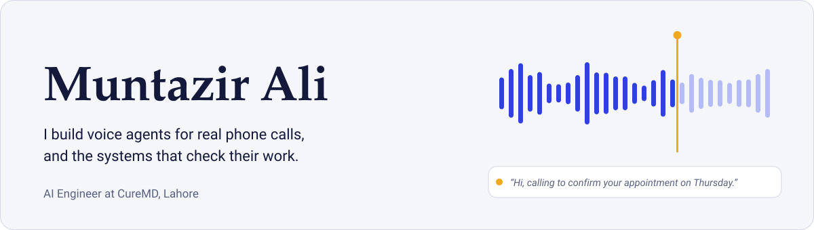
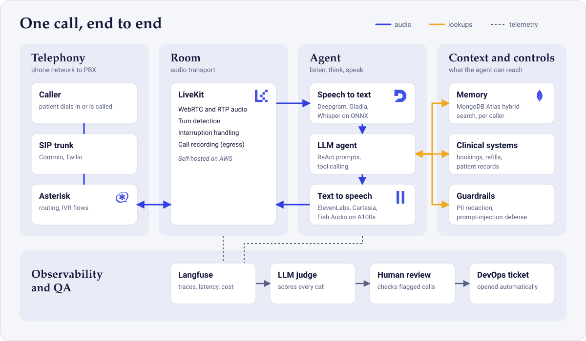
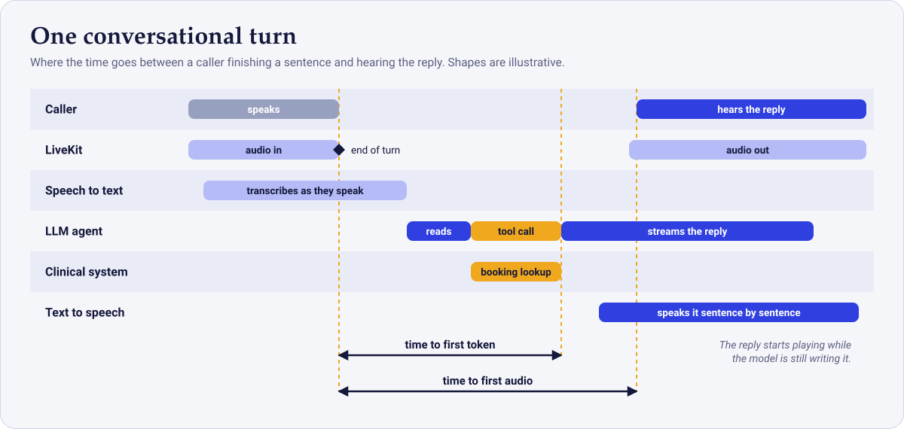
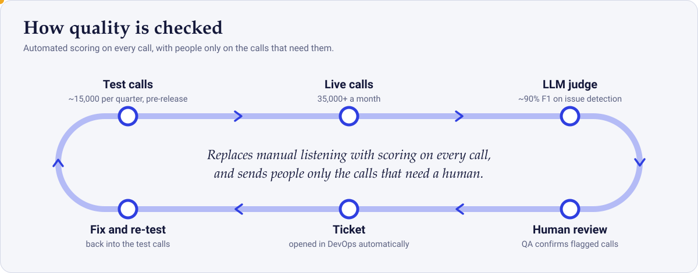
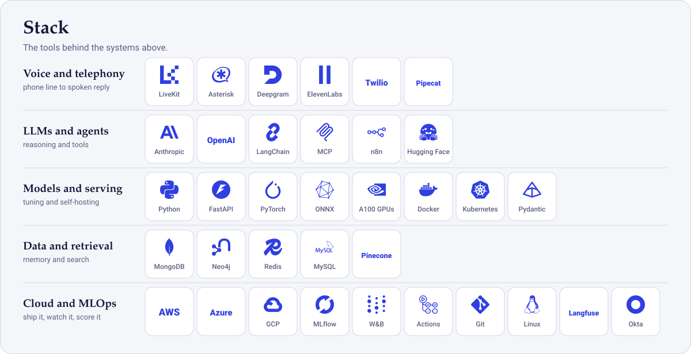

  &nbsp;
  &nbsp;
  &nbsp;
  

## About

I'm an AI Engineer at [CureMD](https://www.curemd.com) in Lahore. My main job is R&D with a clear finish line: take a hard problem, build a working solution and a demo, present it to the CEO, CTO and product leads, then carry it into the production product.

Most of that work sits where real-time voice, LLM agents and healthcare meet. I build the telephony, speech, orchestration, evaluation and observability layers that let an AI agent hold a natural conversation on a live phone call, and then I make sure we can measure whether it did a good job.

Right now I'm working on long-term caller memory, deeper LLM evaluation, and learning Apache Airflow.

## Selected work

### AI Contact Center

A multi-agent Voice AI platform that runs a healthcare contact center around the clock: appointment booking, refills, telemedicine scheduling and reminder calls. It handles **1,000+ calls a day** across 10 US practices, in 10+ languages including Urdu.

[Live demo](https://www.curemd.com/ai-contact-center) &nbsp;|&nbsp; [Demo video](https://www.youtube.com/watch?v=CcTG_DFkl18)

The part I find most interesting is latency. A caller notices every extra half second, so I instrument each stage of a turn (time to first token, time to first audio, token and speech spend) per call and per workflow in Langfuse, and tune from there.

**What it changed**

| Result | Detail |
|---|---|
| About 98% fewer missed and dropped calls (estimate) | Phone coverage extended to 24/7 |
| 15% lower no-show rate | Automated reminder calls across 10 US practices |
| Lower average handle time | Long-term caller memory on MongoDB Atlas with hybrid `$rankFusion` search |
| 4x lower model-serving cost | Caching, batching and routing between open-source and frontier models |

**How it's built**

- **Telephony:** SIP trunking and call routing with Asterisk (ARI/AGI, dial plans, queues), Twilio and Commio, plus self-hosted LiveKit with egress recording.
- **Speech:** low-latency STT and TTS, including self-hosted ONNX-optimized Whisper and Fish Audio / Kokoro on A100 GPUs.
- **Conversation:** turn detection and interruption handling through LiveKit and Pipecat, with 150+ ReAct-tuned prompts for clinical dialogues.
- **Safety:** input and output guardrails, PII redaction and prompt-injection defense.
- **Infrastructure:** AWS, Docker, Kubernetes, Redis, MySQL; CI/CD on Azure DevOps; MLflow and SageMaker for experiment tracking, registry and retraining.

### Automated QA for production voice agents

I replaced manual call monitoring (1,000+ calls a day, about 35,000 a month) with an LLM-powered evaluation system. It covers the whole lifecycle: pre-production testing at roughly 15,000 test calls a quarter, post-production scoring, issue detection, human verification, and automatic DevOps ticket creation. It checks transcripts, audio quality, tool calling, agent transfers, business logic and edge cases, and reaches about **90% F1** on issue detection.

### More projects

<b>Clinical knowledge graph from provider notes</b>

 

Turned 50,000+ unstructured provider notes into a queryable Neo4j knowledge graph using transformer-based NLP and a RAG framework. Entity extraction accuracy reached 92%, and the graph maps patient-diagnosis relationships for treatment-pattern analysis.

<b>Brain tumor segmentation (research paper, submitted)</b>

 

A novel encoder-decoder architecture that improves Dice score by 5% over U-Net on the Figshare dataset. It processes 3D MRI scans in PyTorch with 40% better GPU utilization, and uses noise suppression to sharpen tumor boundaries across 10,000+ medical images.

<b>n8n voice coach for WhatsApp</b>

 

An n8n workflow that acts as a personal fitness companion on WhatsApp. People send text, voice notes or video, and it replies with workout plans, diet reminders and daily motivation, with Google Calendar for gym scheduling and Google Maps for location-based reminders.

<b>Blood glucose prediction with explainable AI</b>

 

An ML model that predicts blood glucose levels, with Explainable AI so clinicians can see why a prediction was made.

## Stack

<b>Full list as text</b>

 

| | |
|---|---|
| **Voice and telephony** | LiveKit, Pipecat, SIP, RTP, WebRTC, Asterisk, Twilio, Commio, Deepgram, Gladia, Whisper, Wav2Vec2, Vosk, ElevenLabs, Cartesia, Fish Audio, Kokoro, Piper |
| **LLMs and agents** | OpenAI, Anthropic, AWS Bedrock, LangChain, LangGraph, MCP, A2A, ReAct, tool calling, structured outputs, multi-agent orchestration |
| **Retrieval and data** | MongoDB Atlas, Pinecone, FAISS, pgvector, Neo4j, Redis, MySQL, embeddings and reranking, knowledge graphs |
| **Models and serving** | PyTorch, Transformers, ONNX, LoRA / QLoRA / PEFT, Hugging Face, vLLM, Ollama, Unsloth, A100 workloads |
| **Evaluation and observability** | Langfuse, LLM-as-judge, regression testing, guardrails, PII redaction, prompt-injection defense |
| **MLOps and cloud** | MLflow, SageMaker, Vertex AI, Weights & Biases, Azure DevOps, GitHub Actions, Docker, Kubernetes, AWS (Lambda, EC2, S3), n8n |
| **Everyday** | Python, FastAPI, AsyncIO, Pydantic, Claude Code, Git, Linux, Okta / OIDC |

## Experience

| | |
|---|---|
| **AI Engineer, [CureMD](https://www.curemd.com)** Jul 2024 to present | Production Voice AI, agentic systems, LLM evaluation and MLOps for an EHR/EMR software vendor. Fine-tuned LLaMA and Mistral with LoRA/PEFT, and integrated agents with EHR and telephony systems firsthand. |
| **Freelance AI Engineer, Upwork** About 3 months | Built and deployed outbound Voice AI on LiveKit for a client's university-admissions sales team in Europe. Worked directly with the client to find and fix what was going wrong. |
| **AI/ML Bootcamp, Qubit Dynamics** Jul to Sep 2024 | Trained speech-to-text models and built gesture recognition, video object detection and text-emotion systems with CNNs, RNNs and LSTMs. |

## Education

**B.E. Electrical Engineering**, Institute of Space Technology, Islamabad (2020 to 2024). Graduated in the top 1% of the batch. Author of *Deep Learning-Based Brain Tumor Segmentation* (submitted).

<b>Certifications</b>

 

| Certification | Issuer | Date |
|---|---|---|
| [Generative AI with AWS](https://www.udacity.com/certificate/e/bb8631ac-4526-11f0-99aa-abcb24deb7aa) | AWS, via Udacity | Jun 2025 |
| [AI for Medicine Specialization](https://www.coursera.org/account/accomplishments/specialization/FK1YIZ53ZL28) | DeepLearning.AI | Jan 2025 |
| [Applied Data Science with Python](https://www.coursera.org/account/accomplishments/specialization/CUC1ZDXWSZKE) | University of Michigan | Jan 2025 |
| [Neo4j & LLM Fundamentals](https://graphacademy.neo4j.com/c/30bbcb72-6848-46e0-8b62-b1f6305b4001/) | Neo4j | Dec 2024 |
| [Machine Learning Specialization](https://www.coursera.org/account/accomplishments/specialization/TDAIFL8TEWEE) | IBM | Oct 2024 |
| [Advanced Algorithms and Complexity](https://www.coursera.org/account/accomplishments/records/30OOSZWTR35X) | UC San Diego | Sep 2024 |
| [Data Structures](https://www.coursera.org/account/accomplishments/verify/NAZDGWL7GWHK) | UC San Diego | Aug 2024 |
| [Python Mega Course](https://www.udemy.com/certificate/UC-ff6058da-869b-4b4f-aaec-689c00b0b772/) | Udemy | Aug 2024 |
| [Aspire Leadership Program](https://drive.google.com/file/d/1HB8osXzYk3NOIO1l0xfpcZCx1A4Y1Fy-/view?usp=sharing) | Harvard University | Apr 2024 |

## Get in touch

I like talking about voice agents, evaluating LLM systems, and getting AI from demo to production.

  &nbsp;
  &nbsp;
  &nbsp;
  

